<picture>
  <source media="(prefers-color-scheme: dark)" srcset="./assets/hero3d-dark.svg" />
  <source media="(prefers-color-scheme: light)" srcset="./assets/hero3d-light.svg" />
  
</picture>

### Hi, I'm Truong

Full-stack developer at **[ABC Digital](https://github.com/abc-software-solutions-company)**. I build and ship web and mobile products end-to-end — from API and database design to the interface, CI/CD and production.

### Experience

**Full-Stack Developer · ABC Digital** — 2025 – present

- Deliver client and internal products across e-commerce, healthcare, booking, HR, recruitment, loyalty and marketing domains.
- Build backend services with NestJS and PostgreSQL: REST APIs, authentication (JWT, OAuth, Microsoft SSO), role-based access, real-time features, background jobs, file storage and email.
- Develop customer-facing websites with Next.js, admin dashboards with React and Vite, and mobile apps with React Native and Expo.
- Integrate LLM APIs (Claude, Gemini) into products and internal tools.
- Run pnpm monorepos, containerise services with Docker and ship through GitHub Actions CI/CD to VPS (Nginx, Caddy, PM2) and Vercel.
- Work in an agile team with code review, written specs and automated tests.

### Tech stack

<picture>
  <source media="(prefers-color-scheme: dark)" srcset="./assets/orbit3-dark.svg" />
  <source media="(prefers-color-scheme: light)" srcset="./assets/orbit3-light.svg" />
  
</picture>

### What I focus on

- **Product delivery** — turning requirements into shipped features across web, admin and mobile.
- **Clean, typed architecture** — shared TypeScript contracts, modular services and maintainable monorepos.
- **Reliability** — automated tests, CI/CD and containerised, reproducible deployments.

### Stats

  <picture>
    <source media="(prefers-color-scheme: dark)" srcset="https://streak-stats.demolab.com/?user=IamPatricKKK&card_width=460&border_radius=8&background=0D1117&border=3D444D&stroke=3D444D&ring=4493F8&fire=AB7DF8&currStreakNum=F0F6FC&sideNums=F0F6FC&currStreakLabel=4493F8&sideLabels=9198A1&dates=9198A1" />
    
  </picture>
  <picture>
    <source media="(prefers-color-scheme: dark)" srcset="https://github-readme-stats.vercel.app/api/top-langs/?username=IamPatricKKK&layout=compact&langs_count=4&card_width=330&hide=html%2Ccss%2Cplpgsql%2Cbatchfile%2Cdockerfile&exclude_repo=64132786_Web2%2CWeb2_PhamXuanTruong%2CGameNe%2CTheGameNe%2CGAMENEE&border_radius=8&bg_color=0d1117&border_color=3d444d&title_color=f0f6fc&text_color=9198a1" />
    
  </picture>

<picture>
  <source media="(prefers-color-scheme: dark)" srcset="./assets/activity-dark.svg" />
  <source media="(prefers-color-scheme: light)" srcset="./assets/activity-light.svg" />
  
</picture>
