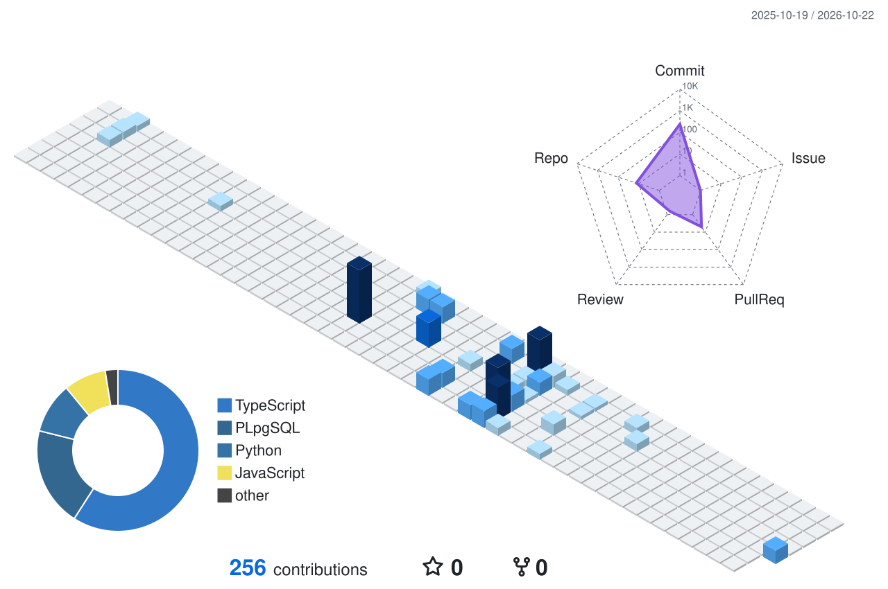

<picture>
  <source media="(prefers-color-scheme: dark)" srcset="./assets/hero3d-dark.svg" />
  <source media="(prefers-color-scheme: light)" srcset="./assets/hero3d-light.svg" />
  
</picture>

### Hi, I'm Truong

Full-stack developer at **[ABC Digital](https://github.com/abc-software-solutions-company)**. I build and ship web and mobile products end-to-end — from API and database design to the interface, CI/CD and production.

### Experience

**Full-Stack Developer · ABC Digital** — 2025 – present

- Deliver client and internal products across e-commerce, booking, HR, loyalty and marketing domains.
- Design and build backend services and REST APIs, including authentication, role-based access and third-party integrations.
- Develop customer-facing websites, admin dashboards and cross-platform mobile apps.
- Set up monorepos, containerised environments and CI/CD pipelines from staging to production.
- Work in an agile team with code review, written specs, automated testing and AI-assisted workflows.

### Tech stack

**Languages** &nbsp; TypeScript · JavaScript · Python · SQL  
**Frontend** &nbsp; React · Next.js · React Native · Tailwind CSS  
**Backend** &nbsp; NestJS · Node.js · FastAPI · PostgreSQL  
**DevOps** &nbsp; Docker · GitHub Actions · Linux · Vercel

### Side projects

- **[Vietnam Air Quality](https://github.com/IamPatricKKK/air-quality-fe)** — realtime air-quality platform with data ingestion, forecasting and an offline-first PWA.
- **[LenKeo](https://github.com/IamPatricKKK/LenKeo)** — plan group purchases and split the bill ([live](https://share-bill-three.vercel.app)).
- **[Computer vision experiments](https://github.com/IamPatricKKK/helmet-detection-whith-YOLO)** — helmet and emotion detection with YOLOv8 and PyTorch.

### Activity

<picture>
  <source media="(prefers-color-scheme: dark)" srcset="./profile-3d-contrib/profile-3d-dark.svg" />
  <source media="(prefers-color-scheme: light)" srcset="./profile-3d-contrib/profile-3d-light.svg" />
  
</picture>
